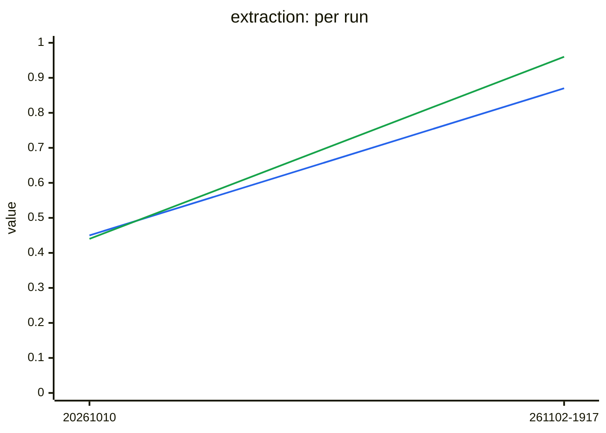

# Extraction benchmark results

Generated from `history.jsonl` — do not edit by hand.

Each full live run of the extraction benchmark (`python -m tests.benchmarks.extraction.run`, from
`lib/`) appends one summary line to `history.jsonl` and regenerates this page; commit both to
record the run. Partial runs (`--case`) and runs with `--no-history` are not recorded. The
detailed report of a run stays in `extraction/.reports/` (gitignored). To record a past run or
re-render this page: `python -m tests.benchmarks.common.history add <scores.json> --module extraction
[--note ...]` and `python -m tests.benchmarks.common.history render --module extraction`.

One sample per case: treat a single case moving as noise, and a whole group moving as a signal.

Value: mean hit rate: share of expected values found in the answers.

## Latest run

`20261102-191757` · commit `35955a5` · gpt-4o · 4 cases, 4 runs · judge gpt-4o-mini · 1104k tokens · *calls through LiteLLM (#190), console off by default (#191), Python 3.12*

| | value | questions answered |
|---|---|---|
| **all** | 0.87 ▲0.42 `▄▇` | 0.96 ▲0.52 `▄█` |

Each cell: latest value, ▲/▼ change since the previous run, and the history as a sparkline (`▁` = 0, `█` = 1).

## Trend

*Lines: blue = all, green = questions answered.*

## By case (latest run)

Show all cases

| case | value | answered |
|---|---|---|
| basic_profile | 0.86 `▇▇` | 1.00 |
| contact_info | 1.00 ▲0.67 `▃█` | 1.00 |
| multi_domain | 0.80 ▲0.20 `▅▇` | 0.83 |
| skills_and_preferences | 0.83 ▲0.83 `▁▇` | 1.00 |

## All runs

| run | commit | models | cases | value | tokens | latency | note |
|---|---|---|---|---|---|---|---|
| 20261102-191757 | `35955a5` | gpt-4o | 4 | 0.87 | 1104k | 528s | calls through LiteLLM (#190), console off by default (#191), Python 3.12 |
| 20261010 | `421622f` | gpt-4o | 4 | 0.45 | 2389k | 640s | **baseline** [`results/2026-10-10-gpt-4o/`](../../results/2026-10-10-gpt-4o/) first committed run (#131), at 421622f: the run at d00f477 died on an unparseable judge reply, which 421622f retries. The KB query agent loops until it gives up: skills_and_preferences (0.0, all 4 answers empty) took 306 agent calls and multi_domain 269 (blue-data-kb-source#133). |

`*` = run made with uncommitted changes. Later runs are compared with the baseline, run `20261010`: a case more than the tolerance below its baseline value is reported as a regression.
