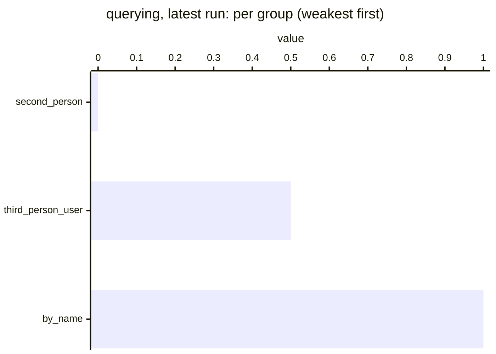

# Querying benchmark results

Generated from `history.jsonl` — do not edit by hand.

Each full live run of the querying benchmark (`python -m tests.benchmarks.querying.run`, from
`lib/`) appends one summary line to `history.jsonl` and regenerates this page; commit both to
record the run. Partial runs (`--case`) and runs with `--no-history` are not recorded. The
detailed report of a run stays in `querying/.reports/` (gitignored). To record a past run or
re-render this page: `python -m tests.benchmarks.common.history add <scores.json> --module querying
[--note ...]` and `python -m tests.benchmarks.common.history render --module querying`.

One sample per case: treat a single case moving as noise, and a whole group moving as a signal.

Value: mean hit rate: share of expected facts retrieved.

## Latest run

`20261010` · commit `d00f477` · gpt-4o · 5 cases, 5 runs · judge gpt-4o-mini · 988k tokens · snapshot [`results/2026-10-10-gpt-4o/`](../../results/2026-10-10-gpt-4o/) · **baseline** · *first committed run (#131). Every query was rewritten to the user's name, but the KB query agent sometimes loops until it gives up and returns nothing: the three 0.0 cases took 61-121 agent calls against 14-20 for the two that succeeded, and skills_second_person scored 1.0 in a probe minutes earlier (blue-data-kb-source#133).*

| | value |
|---|---|
| **all** | 0.40 |
| by_name (1) | 1.00 |
| second_person (2) | 0.00 |
| third_person_user (2) | 0.50 |

Each cell: latest value, ▲/▼ change since the previous run, and the history as a sparkline (`▁` = 0, `█` = 1).

## Trend

```mermaid
%%{init: {"themeVariables": {"xyChart": {"plotColorPalette": "#2563eb, #16a34a, #dc2626, #9333ea"}}}}%%
xychart-beta
    title "querying: per run"
    x-axis ["20261010"]
    y-axis "value" 0 --> 1
    line [0.40]
    line [1.00]
    line [0.00]
    line [0.50]
```

*Lines: blue = all, green = by_name, red = second_person, purple = third_person_user.*

## By group



## By case (latest run)

<details><summary>Show all cases</summary>

| case | group | value |
|---|---|---|
| skills_by_name | by_name | 1.00 |
| preferences_second_person | second_person | 0.00 |
| skills_second_person | second_person | 0.00 |
| career_by_user_pronoun | third_person_user | 0.00 |
| skills_third_person_user | third_person_user | 1.00 |

</details>

## All runs

| run | commit | models | cases | value | tokens | latency | note |
|---|---|---|---|---|---|---|---|
| 20261010 | `d00f477` | gpt-4o | 5 | 0.40 | 988k | 351s | **baseline** [`results/2026-10-10-gpt-4o/`](../../results/2026-10-10-gpt-4o/) first committed run (#131). Every query was rewritten to the user's name, but the KB query agent sometimes loops until it gives up and returns nothing: the three 0.0 cases took 61-121 agent calls against 14-20 for the two that succeeded, and skills_second_person scored 1.0 in a probe minutes earlier (blue-data-kb-source#133). |

`*` = run made with uncommitted changes. Later runs are compared with the baseline, run `20261010`: a case more than the tolerance below its baseline value is reported as a regression.
