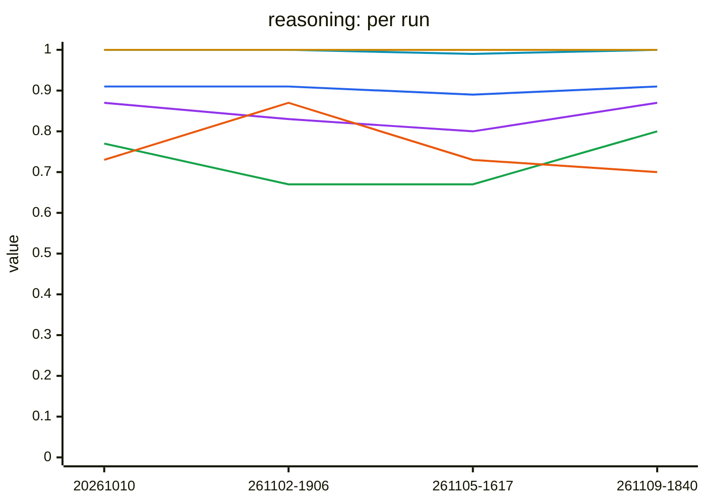
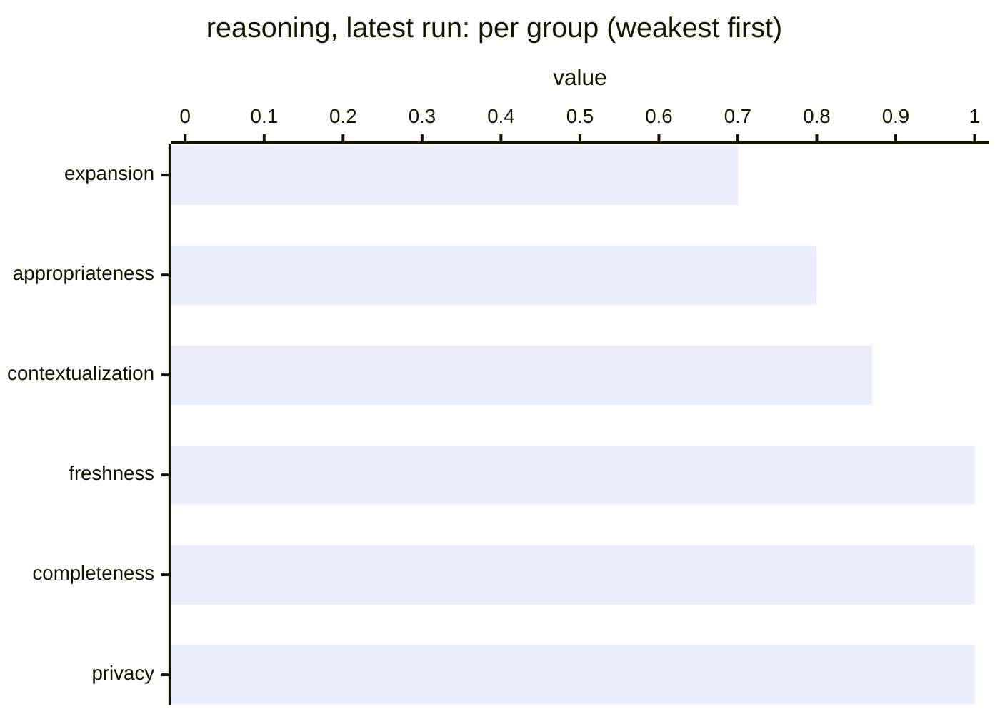

# Reasoning benchmark results

Generated from `history.jsonl` — do not edit by hand.

Each full live run of the reasoning benchmark (`python -m tests.benchmarks.reasoning.run`, from
`lib/`) appends one summary line to `history.jsonl` and regenerates this page; commit both to
record the run. Partial runs (`--case`, `--type`) and runs with `--no-history` are not recorded. The
detailed report of a run stays in `reasoning/.reports/` (gitignored). To record a past run or
re-render this page: `python -m tests.benchmarks.common.history add <scores.json> --module reasoning
[--note ...]` and `python -m tests.benchmarks.common.history render --module reasoning`.

One sample per case: treat a single case moving as noise, and a whole group moving as a signal.

Value: mean case value: 1/0 for a metric decision (completeness, freshness, privacy) that is / is not the expected one, else the judged score.

## Latest run

`20261109-184043` · commit `da99c5d` · gpt-4o · 22 cases, 22 runs · judge gpt-4o-mini · 5k tokens · *blue-data-kb-source at 24ffe22: extraction looks for what the text is about first (blue-data-kb-source#189), schema expansion connects unreachable classes (#190); email login fix #212; blue-data at 3436ec0*

| | value |
|---|---|
| **all** | 0.91 ▲0.02 `████` |
| appropriateness (3) | 0.80 ▲0.13 `▇▆▆▇` |
| completeness (3) | 1.00 `████` |
| contextualization (3) | 0.87 ▲0.07 `▇▇▇▇` |
| expansion (3) | 0.70 ▼0.03 `▆▇▆▆` |
| freshness (5) | 1.00 ▲0.01 `████` |
| privacy (5) | 1.00 `████` |

Each cell: latest value, ▲/▼ change since the previous run, and the history as a sparkline (`▁` = 0, `█` = 1).

## Trend

*Lines: blue = all, green = appropriateness, red = completeness, purple = contextualization, orange = expansion, teal = freshness, yellow = privacy.*

## By group

## By case (latest run)

Show all cases

| case | group | value | score |
|---|---|---|---|
| appropriateness_email | appropriateness | 0.80 `██▇▇` | — |
| appropriateness_stdio | appropriateness | 0.70 ▲0.40 `▅▂▃▆` | — |
| appropriateness_webhook | appropriateness | 0.90 `████` | — |
| completeness_empty | completeness | 1.00 `████` | 0.00 |
| completeness_rich_profile | completeness | 1.00 `████` | 0.80 |
| completeness_sparse_profile | completeness | 1.00 `████` | 0.10 |
| ctx_career_query | contextualization | 0.80 `█▇▇▇` | — |
| ctx_location_query | contextualization | 0.90 ▲0.10 `█▇▇█` | — |
| ctx_skills_query | contextualization | 0.90 ▲0.10 `▇█▇█` | — |
| exp_job_query | expansion | 1.00 `████` | — |
| exp_learning_query | expansion | 0.80 `▇▇▇▇` | — |
| exp_relocation_query | expansion | 0.30 ▼0.10 `▄▇▄▃` | — |
| freshness_empty | freshness | 1.00 `████` | 0.00 |
| freshness_mixed_nodes | freshness | 0.98 ▲0.03 `████` | — |
| freshness_moderate | freshness | 1.00 `████` | 0.75 |
| freshness_recent | freshness | 1.00 `████` | 1.00 |
| freshness_stale | freshness | 1.00 `████` | 0.00 |
| privacy_minimal_consent_detailed | privacy | 1.00 `████` | 0.20 |
| privacy_no_restrictions | privacy | 1.00 `████` | 0.80 |
| privacy_public_sharing | privacy | 1.00 `████` | 1.00 |
| privacy_sensitive_exposure | privacy | 1.00 `████` | 0.00 |
| privacy_sensitive_safe_results | privacy | 1.00 `████` | 1.00 |

*score*: the metric's own reading, for a metric case; its value is whether the pass/fail decision is the expected one.

## All runs

| run | commit | models | cases | value | tokens | latency | note |
|---|---|---|---|---|---|---|---|
| 20261109-184043 | `da99c5d` | gpt-4o | 22 | 0.91 | 5k | 32s | blue-data-kb-source at 24ffe22: extraction looks for what the text is about first (blue-data-kb-source#189), schema expansion connects unreachable classes (#190); email login fix #212; blue-data at 3436ec0 |
| 20261105-161709 | `1fff0fd` | gpt-4o | 22 | 0.89 | 5k | 30s | milestone fixes #194-#207, #210; blue-data at 78e57b3 with its locked FileVectorSource (#272) |
| 20261102-190647 | `35955a5` | gpt-4o | 22 | 0.91 | 5k | 31s | calls through LiteLLM (#190), console off by default (#191), Python 3.12 |
| 20261010 | `d00f477` | gpt-4o | 22 | 0.91 | 5k | 19s | **baseline** [`results/2026-10-10-gpt-4o/`](../../results/2026-10-10-gpt-4o/) first committed run (#131). One sample per case: exp_relocation_query scored 1.0 in an earlier probe and 0.40 here. |

`*` = run made with uncommitted changes. Later runs are compared with the baseline, run `20261010`: a case more than the tolerance below its baseline value is reported as a regression.
